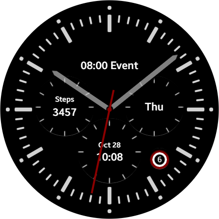
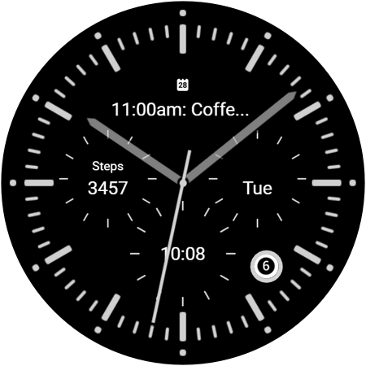
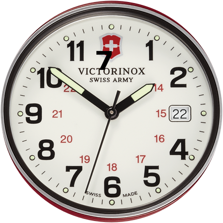
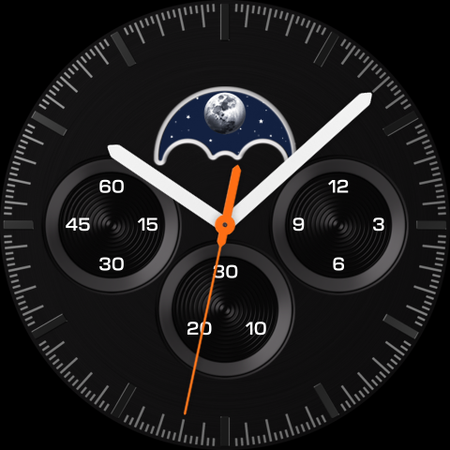
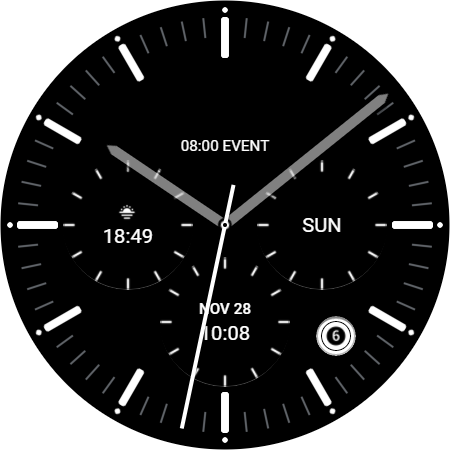
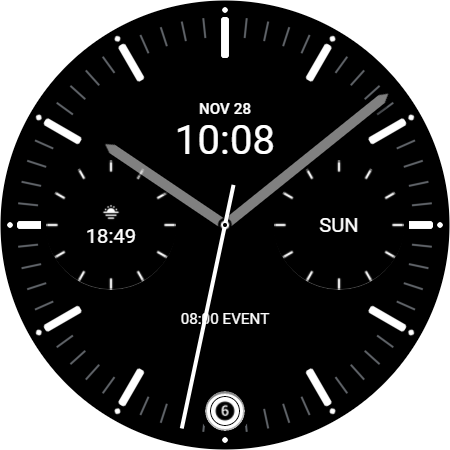
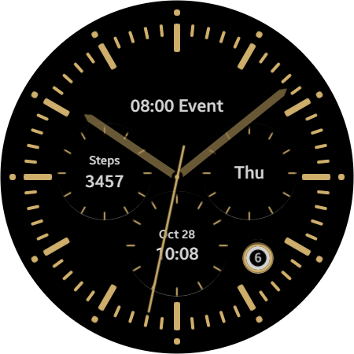
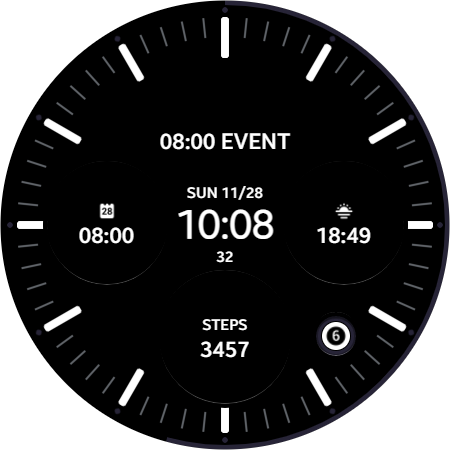
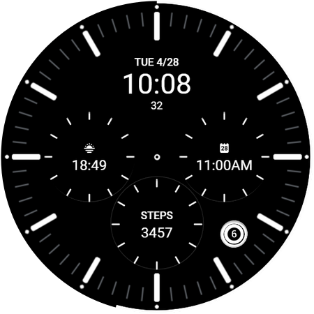
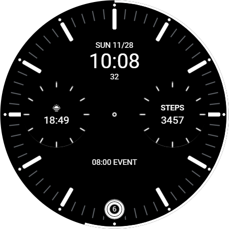

# Watch Face Studio Projects

Watch Face Studio project files (`.wfs`) for my published watch faces, copied from OneDrive (originals untouched). The project binaries are attached to the [v1.0 release](../../releases/tag/v1.0).

## Screenshots

The previews below are Watch Face Studio's own renders, extracted from each `.wfs` project (its embedded `latest_preview.png`).

*Samsung analog: black analog dial, steps subdial, red second hand.*

*Samsung analog 2.0: the same dial family in grayscale.*

*Swiss Army: Victorinox field watch, white dial, date window.*

*Sporty Classic Editable: black chronograph with moonphase window.*

*Versatile analog A: black analog with sunset subdial.*

*Versatile analog B: black analog with digital time readout.*

*Versatile analog GE: gold-on-black analog.*

*Versatile digital: digital face with alarm, sunset, and steps.*

*Versatile hybrid A: hybrid with digital time and event subdials.*

*Versatile hybrid B: hybrid with digital time and steps subdial.*

## Projects

| Project | Approx. size | Last modified (OneDrive) |
|---|---|---|
| Samsung analog 2_0.wfs | 2.85 MB | Apr 3, 2026 |
| Samsung analog.wfs | 55.0 MB | Apr 1, 2026 |
| Swiss Army.wfs | 2.23 MB | Apr 23, 2026 |
| Versatile analog A.wfs | 6.50 MB | Dec 6, 2024 |
| Versatile analog B.wfs | 9.68 MB | Dec 6, 2024 |
| Versatile analog GE.wfs | 53.0 MB | Dec 6, 2024 |
| Versatile digital.wfs | 59.8 MB | Nov 8, 2021 |
| Versatile hybrid A.wfs | 5.90 MB | Apr 3, 2026 |
| Versatile hybrid B.wfs | 63.5 MB | Nov 8, 2021 |

These watch faces were sold on Google Play. Open a `.wfs` file in Watch Face Studio to view or edit the project.
